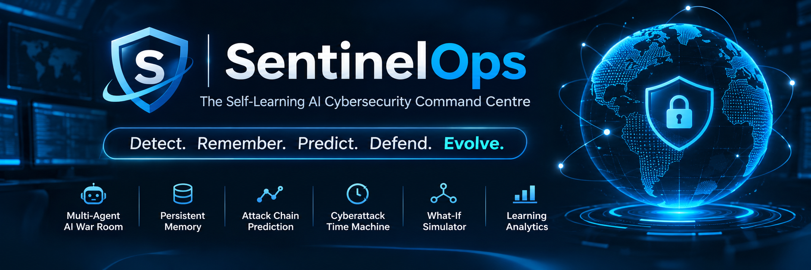

<p align="center">
  
</p>
# 🛡️ SentinelOps
## The Self-Learning AI Cybersecurity Command Centre

**Detect. Remember. Predict. Defend. Evolve.**

SentinelOps is an AI-powered cybersecurity incident response platform designed to transform how security incidents are investigated and handled. By combining multi-agent intelligence, persistent memory and predictive analysis, SentinelOps enables a system that learns from previous incidents and uses that knowledge to support future security decisions.

Unlike traditional approaches that analyse incidents independently, SentinelOps introduces a memory-driven investigation workflow where AI agents collaborate, recall historical experiences, identify patterns and recommend defensive strategies.

---

## 🚀 Project Overview

SentinelOps acts as an intelligent cybersecurity command centre powered by six specialised AI agents coordinated through a central orchestrator.

The platform is designed to:
- Investigate suspicious security activities.
- Recall relevant historical incidents using persistent AI memory.
- Predict possible attack progression.
- Generate evidence-based defensive recommendations.
- Compare incidents to identify recurring patterns.
- Evaluate investigation quality and learning over time.

## ✨ Core Features

### 1. Multi-Agent AI War Room
Six specialised agents collaborate to analyse security incidents.

- **Detective Agent:** Investigates incident evidence and identifies suspicious activity.
- **Memory Agent:** Retrieves relevant historical experiences.
- **Prediction Agent:** Identifies possible future attack stages.
- **Response Strategist:** Develops defensive response recommendations.
- **Auditor Agent:** Reviews recommendations for safety and evidence.
- **Cross-Incident Agent:** Identifies similarities between current and previous incidents.

A central orchestrator coordinates the agents and consolidates their findings into an investigation report.

### 2. Persistent Cybersecurity Memory
Powered by Hindsight, SentinelOps retains and recalls incident information, response decisions and outcomes. This allows historical experience to influence future investigations.

### 3. Attack Chain Prediction
Analyses available incident information and historical context to identify possible next stages of an attack, helping security analysts prioritise further investigation.

### 4. Cyberattack Time Machine
Revisits previous incidents, examines historical response strategies and explores how memory can improve subsequent investigations.

### 5. What-If Attack Simulator
Provides a controlled environment for exploring hypothetical attack scenarios and comparing possible defensive strategies without executing real-world attacks.

### 6. Live Threat Monitor
Uses WebSocket communication to stream security events and display suspicious activity through the command centre.

### 7. Digital Memory Vault
Organises retained incident knowledge, investigation findings and response history for future reference.

### 8. Learning Analytics
Provides an evaluation framework for measuring memory recall, recommendation quality, response outcomes and mistake avoidance.

---

## 🧠 System Architecture

```text
                 SENTINELOPS
                      |
                React Frontend
                      |
             FastAPI REST + WebSocket
                      |
              AI AGENT ORCHESTRATOR
                      |
       +--------------+--------------+
       |              |              |
   Detective        Memory       Prediction
     Agent           Agent          Agent
       |              |              |
       +--------------+--------------+
                      |
       +--------------+--------------+
       |              |              |
   Response        Auditor      Cross-Incident
  Strategist        Agent           Agent
                      |
              AI REASONING + MEMORY
                      |
              +-------+-------+
              |               |
            GROQ           HINDSIGHT
          AI Model       Persistent Memory
              |               |
              +-------+-------+
                      |
              INVESTIGATION REPORT
```

## 🛠️ Technology Stack

| Component | Technologies |
|---|---|
| Frontend | React, Vite |
| Styling | Tailwind CSS, CSS |
| Animations | Framer Motion |
| Visualisation | Recharts |
| Backend | Python, FastAPI |
| AI Integration | Groq API |
| Memory System | Hindsight |
| Real-Time Communication | WebSockets |
| Development Tools | VS Code, Git, GitHub |

---

## 📂 Project Structure

```text
SentinelOps/
│
├── backend/
│   ├── agents/
│   │   ├── auditor.py
│   │   ├── cross_incident_agent.py
│   │   ├── detective.py
│   │   ├── incident_responder.py
│   │   ├── memory_agent.py
│   │   ├── orchestrator.py
│   │   ├── prediction_agent.py
│   │   └── response_strategist.py
│   │
│   ├── api/
│   │   ├── main.py
│   │   └── test_websocket.py
│   │
│   ├── realtime/
│   │   └── event_engine.py
│   │
│   ├── simulation/
│   │   ├── incident_simulator.py
│   │   └── time_machine.py
│   │
│   ├── test_groq.py
│   ├── test_hindsight.py
│   ├── test_memory.py
│   └── verify_memory.py
│
├── frontend/
│   ├── public/
│   └── src/
│       ├── assets/
│       ├── App.jsx
│       ├── App.css
│       ├── index.css
│       ├── main.jsx
│       └── ThreatGlobe.jsx
│
├── requirements.txt
├── .gitignore
└── README.md
```

---

## ⚙️ Installation and Setup

### Prerequisites
- Python 3.11+
- Node.js and npm
- Git
- Groq API credentials
- Hindsight Cloud credentials

### Step 1: Clone the repository

```bash
git clone https://github.com/lsuprita01-glitch/SentinelOps.git
cd SentinelOps
```

### Step 2: Set up the backend

```bash
python -m venv .venv
```

Activate the environment on Windows:

```powershell
.venv\Scripts\Activate.ps1
```

Install dependencies:

```bash
pip install -r requirements.txt
```

### Step 3: Configure environment variables

Create a `.env` file in the root directory:

```env
GROQ_API_KEY=your_groq_api_key
HINDSIGHT_API_KEY=your_hindsight_api_key
HINDSIGHT_BASE_URL=your_hindsight_base_url
```

Keep all credentials private. Never commit `.env` to GitHub.

### Step 4: Start the backend server

```bash
python -m uvicorn backend.api.main:app --host 127.0.0.1 --port 8000 --reload
```

API documentation:

`http://127.0.0.1:8000/docs`

### Step 5: Start the frontend

Open another terminal:

```bash
cd frontend
npm install
npm run dev
```

Open the local development URL displayed in the terminal.

---

## 🔌 Backend API

| Method | Endpoint | Description |
|---|---|---|
| GET | `/` | API status |
| GET | `/health` | Backend health check |
| POST | `/events` | Receive security events |
| POST | `/alerts` | Receive threat alerts |
| WebSocket | `/ws/events` | Real-time event communication |

---

## 🔐 Security and Responsible AI

SentinelOps follows a defensive and human-supervised approach to cybersecurity.

- Synthetic events are used for controlled demonstrations.
- AI-generated predictions are treated as hypotheses, not confirmed incidents.
- Recommendations are subject to evidence and safety checks.
- Sensitive defensive actions require authorised human approval.
- API keys and credentials must remain in environment variables.
- Historical memories provide context but do not independently prove current threats.

---

## 🎯 Project Vision

The vision behind SentinelOps is to develop a cybersecurity system that does more than detect suspicious activity.

By combining collaborative AI agents with persistent memory and incident learning, SentinelOps aims to create a system that continuously builds on previous experiences and supports more informed security investigations.

**From isolated threat detection to intelligent, memory-driven cybersecurity.**

---

## 👩‍💻 Project Information

**Project Name:** SentinelOps

**Category:** AI Agents That Learn Using Hindsight

**Domain:** Engineering & DevOps – Incident Response Agent

**Repository:** [GitHub – SentinelOps](https://github.com/lsuprita01-glitch/SentinelOps)

**Tagline:** Detect. Remember. Predict. Defend. Evolve.

---

<sub>SentinelOps is a hackathon prototype demonstrating AI-assisted cybersecurity investigation through synthetic events and controlled simulations.</sub>
